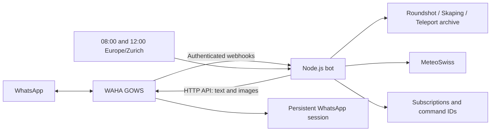

# Architecture

WAHA owns WhatsApp authentication, group metadata, media delivery and message storage. The Node.js worker owns commands, subscriptions, weather, webcam retrieval and scheduling. The worker has no browser dependencies.

`src/waha.js` implements the HTTP adapter and never retries outgoing messages automatically. The webhook receiver verifies a shared secret and accepts commands only for the configured WAHA session. Imported messages older than five minutes and API-generated echoes are ignored.

Command IDs are persisted before processing so webhook retries and worker restarts cannot repeat a response. This favors avoiding duplicate sends: after an ambiguous failure, users must issue a new command. It does not guarantee that a message reached every group member; delivery is checked separately.

The operator API is bound to loopback inside the bot container. Its health endpoint checks the WhatsApp session, so an available HTTP server alone is not reported as a healthy bot.

WAHA configuration is reconciled on worker startup. Unchanged working sessions are not recreated. GOWS session storage persists independently of the worker.
